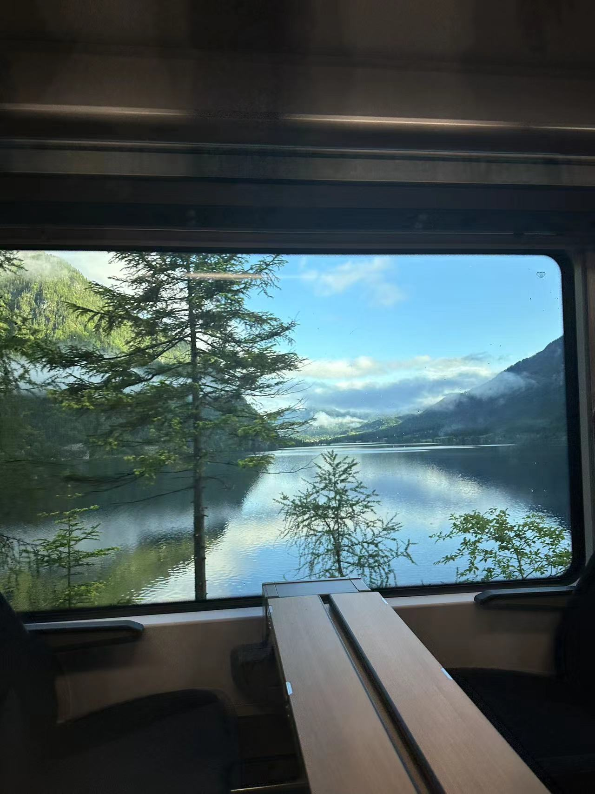
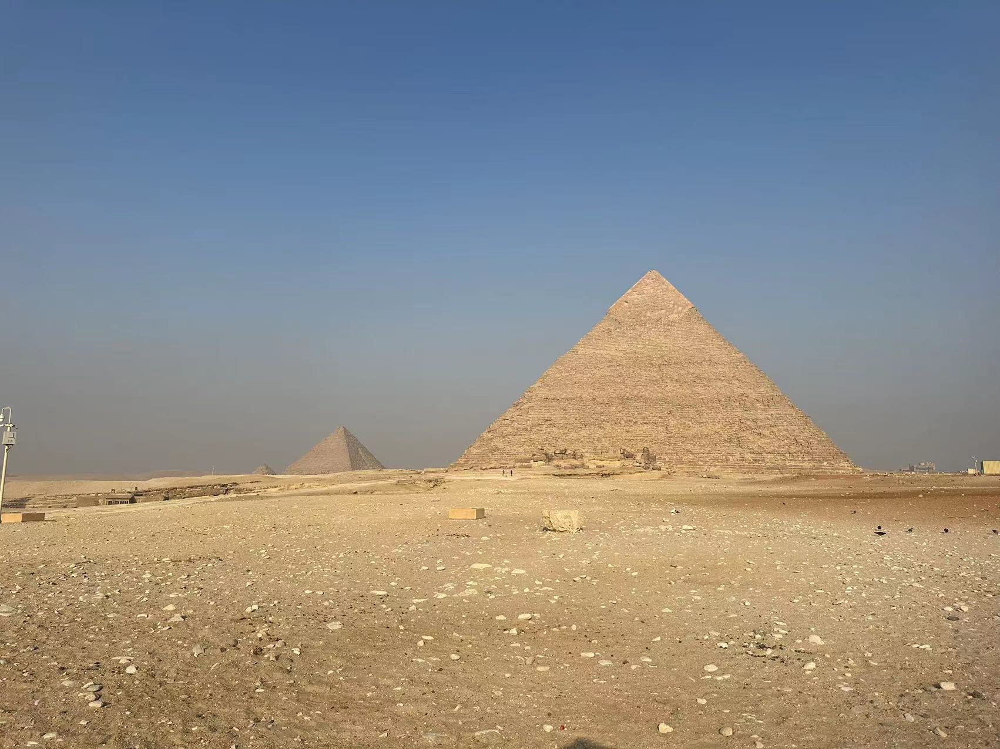
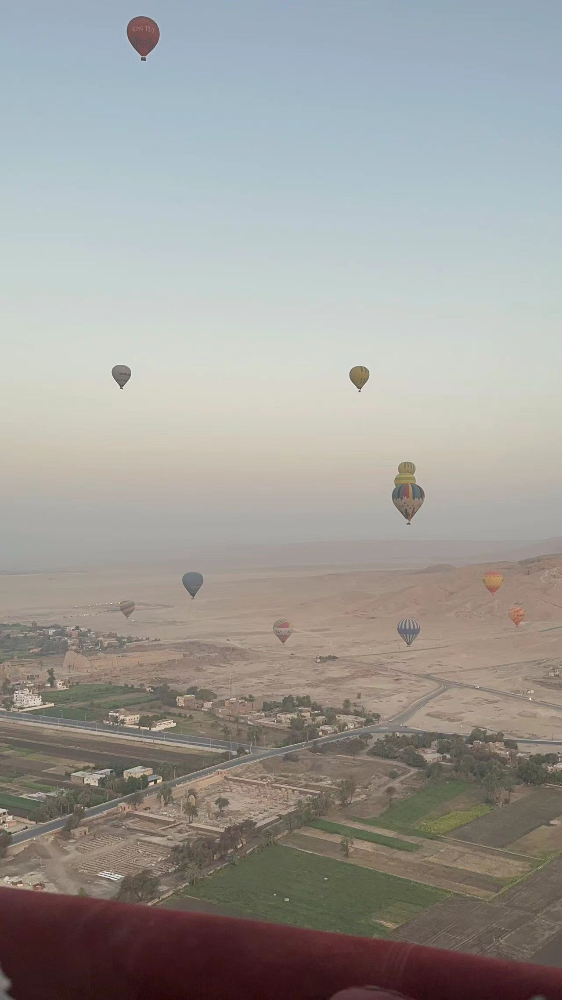
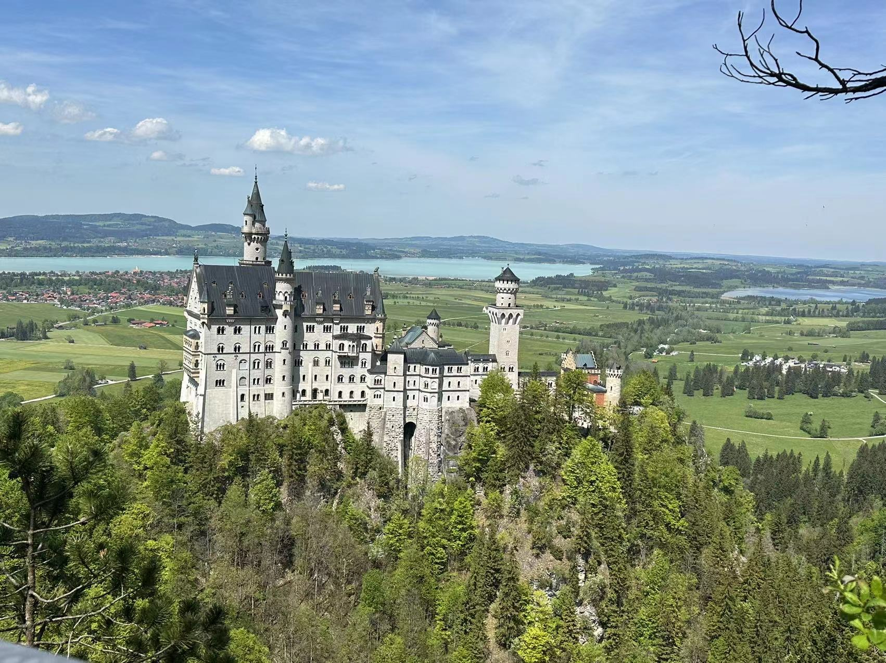

I have tried paragliding, skydiving and hot air ballooning, and found that I like paragliding the most. I plan to get a paragliding license when I have time. (Fly independently!)

### My story
Born and raised in Shanghai, China. After graduating from middle school, followed my parents to Canada and completed my high school and undergraduate there.

Here are some place that I have gone:

*Harschkat, Austria*

*Cairo, Egypt*

*Luxor, Egypt*

*Neuschwanstein Castle, Germany*

